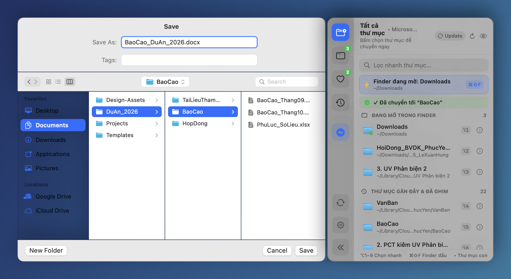
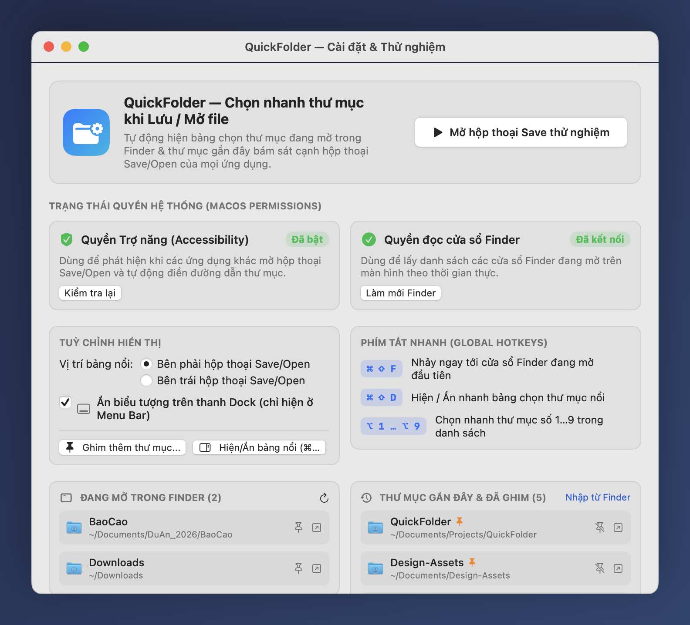

# QuickFolder for macOS

**QuickFolder** là ứng dụng tiện ích siêu nhẹ cho macOS (lấy cảm hứng từ [Default Folder X](https://www.stclairsoft.com/DefaultFolderX/)), tập trung vào việc **chọn nhanh thư mục đích khi Lưu (Save) hoặc Mở (Open) file** từ bất kỳ ứng dụng nào (Microsoft Word, Excel, Chrome, Preview, VS Code...).

<p align="center">
  
</p>

## 📸 Giao diện Cài đặt & Quản lý Thư mục

<p align="center">
  
</p>

## ✨ Tính năng nổi bật (v1.3.7)

- **10 Cải tiến Toàn diện & Nâng cao Trải nghiệm Người dùng**:
  1. **Tìm kiếm tiếng Việt không dấu (Diacritic-Insensitive Search)**: Gõ `baocao`, `tochuc`, `tailieu`, `nghiencuu` tìm chính xác `Báo Cáo`, `02. ToChuc`, `Tài Liệu`, `Nghiên Cứu`.
  2. **Kéo & Thả (Drag & Drop)**: Thả trực tiếp bất kỳ tệp hoặc thư mục nào từ Finder/Desktop vào bảng nổi để hộp thoại Save/Open nhảy tới thư mục đó ngay lập tức.
  3. **Duyệt phím mũi tên ↑ / ↓ + Enter**: Dễ dàng di chuyển lựa chọn và xác nhận thư mục đích bằng bàn phím mà không cần chạm chuột.
  4. **Bảo vệ & Tự dọn dẹp thư mục lỗi (Stale Folder Guard)**: Kiểm tra tính tồn tại của thư mục trước khi điều hướng; cảnh báo an toàn và cung cấp nút dọn sạch các thư mục đã bị xóa/đổi tên.
  5. **Giới hạn viền màn hình thông minh & Đa màn hình (Smart Clamping & Multi-Monitor)**: Tự động đảo lật bên trái/phải và căn chỉnh an toàn không tràn mép màn hình hay che Dock/Menu Bar.
  6. **Xem nhanh thông tin thư mục (Folder Info Tooltip)**: Di chuột vào bất kỳ mục nào để xem ngày sửa đổi gần nhất, dung lượng ổ đĩa còn trống và đường dẫn đầy đủ.
  7. **Tuỳ chọn Mật độ hiển thị Thoải mái / Gọn gàng (Display Density)**: Chuyển đổi linh hoạt giữa chế độ Comfortable (rộng rãi) và Compact (gọn gàng, tăng 30% số lượng mục hiển thị).
  8. **Giao diện Quản lý Ứng dụng Bỏ qua (Excluded Apps Manager)**: Danh mục quản trị trực quan trong Cài đặt, cho phép thêm bất kỳ file `.app` nào từ `/Applications` hoặc gỡ bỏ ứng dụng bị ẩn.
  9. **Nhận diện Tab Finder con (Finder Window Tabs Recognition)**: Nhận diện và liệt kê đầy đủ toàn bộ các tab con đang mở trong cùng một cửa sổ Finder (qua cả Accessibility và AppleScript).
  10. **Lịch sử tệp đã lưu gần đây (Recent Saved Files Tracker)**: Tab riêng biệt trên thanh icon cho phép xem nhanh các tài liệu vừa lưu hoặc chỉnh sửa gần đây kèm nút xem trong Finder hoặc nhảy ngay tới thư mục cha.
- **Cơ chế Điều hướng 2 Tầng Siêu An Toàn & Chuẩn Xác (Không bị cuộn nhầm thanh bên)**:
  - **Tầng 1 (Direct Native Sidebar Click 0ms)**: Bấm trực tiếp vào các mục thanh bên chỉ khi đường dẫn đích là thư mục gốc thực sự (`Downloads`, `Desktop`, `Documents`, `Google Drive` gốc, `OneDrive` gốc...). Xác thực chính xác `where popup` sau khi click để đảm bảo đúng vị trí.
  - **Tầng 2 (Safe Go-To-Folder với Kiểm tra Trợ năng Chặt chẽ)**: Khi điều hướng vào thư mục con lồng sâu (như `02. ToChuc` trong Google Drive), ứng dụng đi thẳng qua `Cmd+Shift+G` và nhập đường dẫn đầy đủ, tuyệt đối không bấm nhầm vào ổ Google Drive gốc ở thanh bên làm cuộn thanh scroll sai lệch. Chỉ gửi phím Return xác nhận khi ô nhập đường dẫn `PathTextField` đã thực sự xuất hiện trên màn hình.
- **Duy trì nhận diện Hộp thoại Save/Open khi chuyển sang Finder**: Khi người dùng bấm vào cửa sổ Finder bất kỳ, QuickFolder vẫn duy trì ghi nhớ hộp thoại Save/Open đang mở ở ứng dụng trước (Safari, Edge, Antigravity, Pages...), cho phép bấm chọn thư mục Finder hoặc dùng Finder-Click để điều hướng ngay lập tức mà không bị mất hiệu ứng.
- **Bảo toàn 100% dữ liệu Clipboard khi điều hướng (Hình ảnh, Định dạng, File, Văn bản)**: Tự động sao lưu toàn diện mọi kiểu dữ liệu trong bộ nhớ tạm và khôi phục nguyên vẹn sau khi thao tác hoàn tất.
- **Nhận diện đầy đủ 100% cửa sổ Finder đang mở (kể cả Google Drive & thư mục lồng sâu)**: Tự động bóc tách đường dẫn trực tiếp từ thanh Path Bar (`AXURL` fileID URL) của Finder.
- **Tuỳ chọn “Khởi động cùng macOS” & “Bật bảng này khi khởi động”**: Tích hợp thanh tuỳ chọn nhanh ngay đầu cửa sổ điều khiển và trên Menu Bar để bạn chủ động chọn tự chạy cùng macOS, mở sẵn bảng điều khiển khi khởi động hoặc chạy ngầm hoàn toàn trên thanh Menu Bar.
- **Nút “Update từ GitHub” 1 chạm ở mọi nơi (Bảng nổi, Cửa sổ Cài đặt & Menu Bar)**: Tích hợp nút **Update từ GitHub** trực tiếp trên thanh bên nổi cạnh hộp thoại Save/Open, trong cửa sổ Cài đặt và trên Menu Bar (`⌘U`) — tự động kiểm tra tag mới nhất trên `hungmtuci/QuickFolder`, tải gói cập nhật kèm thanh tiến trình, thay thế `/Applications/QuickFolder.app`, gỡ cờ cách ly Gatekeeper và khởi động lại ngay lập tức.
- **Thanh bên nổi tự động & Bám theo thời gian thực (`AXObserver` 60fps, ~0% CPU khi nghỉ)**: Tự động xuất hiện bám sát cạnh phải hoặc cạnh trái của hộp thoại `Save` / `Open` qua sự kiện `AXObserver` mà không tốn CPU chạy ngầm khi nghỉ.
- **Finder-Click (Click trực tiếp cửa sổ Finder nằm phía sau)**: Khi hộp thoại Save/Open đang mở, chỉ cần di chuột ra vùng cửa sổ Finder bất kỳ trên màn hình và click 1 lần để nhảy hộp thoại Save tới thẳng thư mục đó.
- **Duyệt cây thư mục con nhiều cấp (`▸`) & Tạo thư mục mới tức thì**: Nút `▸` trên mỗi dòng cho phép duyệt đệ quy toàn bộ cây thư mục con hoặc tạo nhanh thư mục con mới và chuyển hộp thoại Save vào ngay lập tức.
- **Thư mục mặc định riêng cho từng ứng dụng (Per-App Default Folder)**: Gán thư mục quen dùng riêng cho từng app (ví dụ Word, Excel, Chrome) và tuỳ chọn tự động nhảy ngay khi mở hộp thoại Save.
- **Phím tắt thông minh không xung đột IDE**: Tự động chỉ bắt `⌘⇧F` khi hộp thoại Save/Open thực sự đang mở (không bao giờ đè lên *Find in Files* `⌘⇧F` trong VS Code / Xcode / trình duyệt), kèm tuỳ chọn đổi tổ hợp phím tắt.
- **Khởi động êm cùng macOS (`Launch at Login`) & Ẩn trên thanh Dock**: Chạy gọn gàng hoàn toàn trên thanh Menu Bar.

## ⌨️ Phím tắt & Thao tác thông minh

| Phím tắt / Thao tác | Chức năng |
| :--- | :--- |
| `↑` / `↓` + `Enter` | Duyệt danh sách thư mục và xác nhận chuyển ngay bằng bàn phím |
| Kéo & Thả (`Drag & Drop`) | Thả file/thư mục từ Finder vào bảng nổi để Save dialog nhảy ngay tới đó |
| `⌘ ⇧ F` *(hoặc `⌥ F`, `⌃ ⌥ F`)* | Nhảy ngay hộp thoại Save/Open tới cửa sổ Finder đang mở đầu tiên *(chỉ kích hoạt khi đang mở Save/Open)* |
| `⌘ ⇧ D` *(hoặc `⌃ ⌥ D`, `⌥ Space`)* | Hiện / Ẩn nhanh bảng chọn thư mục nổi |
| `⌥ 1` … `⌥ 9` | Chọn nhanh thư mục ở vị trí số `1` … `9` trong danh sách |
| Nút `▸` | Bung menu cây thư mục con nhiều cấp, tạo thư mục con mới hoặc đặt mặc định cho ứng dụng |

---

## 📥 Tải về & Cài đặt nhanh (macOS 14.0+ Universal: Apple Silicon & Intel)

1. Tải bộ cài mới nhất tại trang **[Releases](https://github.com/hungmtuci/QuickFolder/releases/latest)**:
   - **`QuickFolder-Installer-v1.3.7.dmg`** *(Khuyên dùng)*
   - Hoặc **`QuickFolder-v1.3.7-macOS.zip`**
2. Mở file `.dmg`:
   - Kéo `QuickFolder.app` thả vào thư mục **`Applications`**, **HOẶC** nhấp chuột phải vào `Cai_Dat_QuickFolder.command` -> chọn **Open** để tự động cài đặt và gỡ cờ cách ly Gatekeeper.
3. Nếu macOS báo ứng dụng chưa công chứng Apple Developer ID khi mở lần đầu trên máy mới, chạy lệnh sau trong Terminal:
   ```bash
   xattr -cr /Applications/QuickFolder.app && open /Applications/QuickFolder.app
   ```
4. Cấp quyền **Accessibility (Trợ năng)** cho `QuickFolder` trong **System Settings → Privacy & Security → Accessibility** để ứng dụng có thể phát hiện hộp thoại Save/Open và tự động chuyển thư mục.

---

## 🛠️ Tự biên dịch từ mã nguồn (Build from Source)

Yêu cầu: macOS 14.0+ và Xcode hoặc Command Line Tools (`xcode-select --install`).

```bash
git clone https://github.com/hungmtuci/QuickFolder.git
cd QuickFolder
chmod +x build_app.sh scripts/setup_signing_cert.sh

# (Tuỳ chọn) Tạo chứng chỉ ký nội bộ để macOS giữ quyền Accessibility qua các lần build lại:
./scripts/setup_signing_cert.sh

# Biên dịch Universal Binary và tạo bộ cài .dmg / .zip:
./build_app.sh
```

Sau khi chạy xong `./build_app.sh`:
- Ứng dụng Universal Binary (`arm64` + `x86_64`) được tạo tại `./QuickFolder.app`
- Bộ cài `.dmg` và `.zip` được xuất ra tại thư mục `./dist/`

## 📄 Giấy phép

Phát hành theo giấy phép [MIT License](LICENSE).
