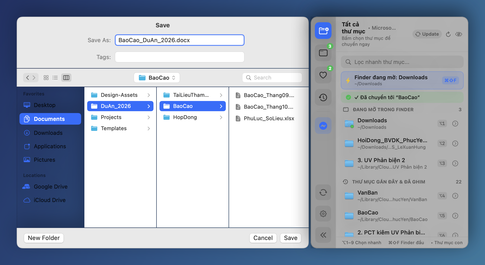
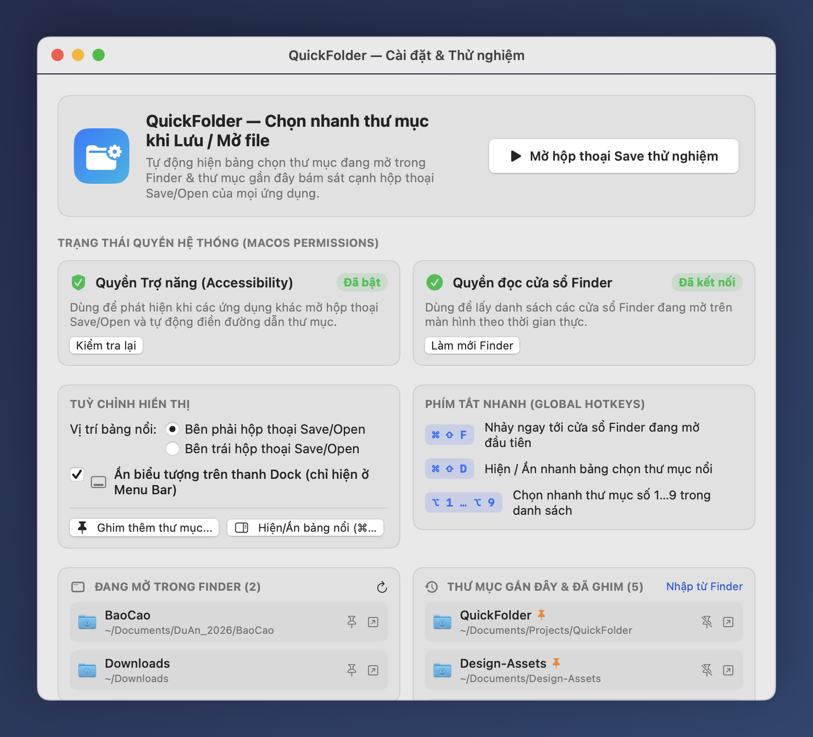

# QuickFolder for macOS

**QuickFolder** là ứng dụng tiện ích siêu nhẹ cho macOS (lấy cảm hứng từ [Default Folder X](https://www.stclairsoft.com/DefaultFolderX/)), tập trung vào việc **chọn nhanh thư mục đích khi Lưu (Save) hoặc Mở (Open) file** từ bất kỳ ứng dụng nào (Microsoft Word, Excel, Chrome, Preview, VS Code...).

<p align="center">
  
</p>

## 📸 Giao diện Cài đặt & Quản lý Thư mục

<p align="center">
  
</p>

## ✨ Tính năng nổi bật (v1.3.5)

- **Cơ chế Điều hướng 2 Tầng Siêu An Toàn (Tuyệt đối không bao giờ bấm nhầm nút Save hay ghi đè file)**:
  - **Tầng 1 (Direct Native Sidebar Click 0ms)**: Nhấp trực tiếp vào danh mục thanh bên (`Downloads`, `Desktop`, `Documents`, `Google Drive`, `OneDrive`, `Dropbox`, User Home, v.v.) qua tọa độ thực mà không cần mở Go-To sheet, không thay đổi clipboard và không mô phỏng phím gõ.
  - **Tầng 2 (Safe Go-To-Folder với Kiểm tra Trợ năng Chặt chẽ)**: Gửi `Cmd+Shift+G` và **chỉ gửi phím Return xác nhận khi ô nhập đường dẫn `PathTextField` đã thực sự xuất hiện trên màn hình**. Nếu sheet không xuất hiện (do bị chặn hoặc ứng dụng đặc biệt), ứng dụng lập tức hủy an toàn — **tuyệt đối không bao giờ gửi phím Return mù** gây lưu đè file.
- **Duy trì nhận diện Hộp thoại Save/Open khi chuyển sang Finder**: Khi người dùng bấm vào cửa sổ Finder bất kỳ, QuickFolder vẫn duy trì ghi nhớ hộp thoại Save/Open đang mở ở ứng dụng trước (Safari, Antigravity, Pages...), cho phép bấm chọn thư mục Finder hoặc dùng Finder-Click để điều hướng ngay lập tức mà không bị mất hiệu ứng.
- **Bảo toàn 100% dữ liệu Clipboard khi điều hướng (Hình ảnh, Định dạng, File, Văn bản)**: Tự động sao lưu toàn diện mọi kiểu dữ liệu trong bộ nhớ tạm và khôi phục nguyên vẹn sau khi thao tác hoàn tất.
- **Nhận diện đầy đủ 100% cửa sổ Finder đang mở (kể cả Google Drive & thư mục lồng sâu)**: Tự động bóc tách đường dẫn trực tiếp từ thanh Path Bar (`AXURL` fileID URL) của Finder.
- **Tuỳ chọn “Khởi động cùng macOS” & “Bật bảng này khi khởi động”**: Tích hợp thanh tuỳ chọn nhanh ngay đầu cửa sổ điều khiển và trên Menu Bar để bạn chủ động chọn tự chạy cùng macOS, mở sẵn bảng điều khiển khi khởi động hoặc chạy ngầm hoàn toàn trên thanh Menu Bar.
- **Nút “Update từ GitHub” 1 chạm ở mọi nơi (Bảng nổi, Cửa sổ Cài đặt & Menu Bar)**: Tích hợp nút **Update từ GitHub** trực tiếp trên thanh bên nổi cạnh hộp thoại Save/Open, trong cửa sổ Cài đặt và trên Menu Bar (`⌘U`) — tự động kiểm tra tag mới nhất trên `hungmtuci/QuickFolder`, tải gói cập nhật kèm thanh tiến trình, thay thế `/Applications/QuickFolder.app`, gỡ cờ cách ly Gatekeeper và khởi động lại ngay lập tức (hỗ trợ cả tải & cài lại bản sạch khi đang ở phiên bản mới nhất).
- **Thanh bên nổi tự động & Bám theo thời gian thực (`AXObserver` 60fps, ~0% CPU khi nghỉ)**: Tự động xuất hiện bám sát cạnh phải hoặc cạnh trái của hộp thoại `Save` / `Open` qua sự kiện `AXObserver` mà không tốn CPU chạy ngầm khi nghỉ.
- **Finder-Click (Click trực tiếp cửa sổ Finder nằm phía sau)**: Khi hộp thoại Save/Open đang mở, chỉ cần di chuột ra vùng cửa sổ Finder bất kỳ trên màn hình và click 1 lần để nhảy hộp thoại Save tới thẳng thư mục đó.
- **Duyệt cây thư mục con nhiều cấp (`▸`) & Tạo thư mục mới tức thì**: Nút `▸` trên mỗi dòng cho phép duyệt đệ quy toàn bộ cây thư mục con hoặc tạo nhanh thư mục con mới và chuyển hộp thoại Save vào ngay lập tức.
- **Thư mục mặc định riêng cho từng ứng dụng (Per-App Default Folder)**: Gán thư mục quen dùng riêng cho từng app (ví dụ Word, Excel, Chrome) và tuỳ chọn tự động nhảy ngay khi mở hộp thoại Save.
- **Phím tắt thông minh không xung đột IDE**: Tự động chỉ bắt `⌘⇧F` khi hộp thoại Save/Open thực sự đang mở (không bao giờ đè lên *Find in Files* `⌘⇧F` trong VS Code / Xcode / trình duyệt), kèm tuỳ chọn đổi tổ hợp phím tắt.
- **Khởi động êm cùng macOS (`Launch at Login`) & Ẩn trên thanh Dock**: Chạy gọn gàng hoàn toàn trên thanh Menu Bar.

## ⌨️ Phím tắt thông minh (Smart Hotkeys)

| Phím tắt (Tuỳ chỉnh được) | Chức năng |
| :--- | :--- |
| `⌘ ⇧ F` *(hoặc `⌥ F`, `⌃ ⌥ F`)* | Nhảy ngay hộp thoại Save/Open tới cửa sổ Finder đang mở đầu tiên *(chỉ kích hoạt khi đang mở Save/Open)* |
| `⌘ ⇧ D` *(hoặc `⌃ ⌥ D`, `⌥ Space`)* | Hiện / Ẩn nhanh bảng chọn thư mục nổi |
| `⌥ 1` … `⌥ 9` | Chọn nhanh thư mục ở vị trí số `1` … `9` trong danh sách |
| Nút `▸` | Bung menu cây thư mục con nhiều cấp, tạo thư mục con mới hoặc đặt mặc định cho ứng dụng |

---

## 📥 Tải về & Cài đặt nhanh (macOS 14.0+ Universal: Apple Silicon & Intel)

1. Tải bộ cài mới nhất tại trang **[Releases](https://github.com/hungmtuci/QuickFolder/releases/latest)**:
   - **`QuickFolder-Installer-v1.3.5.dmg`** *(Khuyên dùng)*
   - Hoặc **`QuickFolder-v1.3.5-macOS.zip`**
2. Mở file `.dmg`:
   - Kéo `QuickFolder.app` thả vào thư mục **`Applications`**, **HOẶC** nhấp chuột phải vào `Cai_Dat_QuickFolder.command` -> chọn **Open** để tự động cài đặt và gỡ cờ cách ly Gatekeeper.
3. Nếu macOS báo ứng dụng chưa công chứng Apple Developer ID khi mở lần đầu trên máy mới, chạy lệnh sau trong Terminal:
   ```bash
   xattr -cr /Applications/QuickFolder.app && open /Applications/QuickFolder.app
   ```
4. Cấp quyền **Accessibility (Trợ năng)** cho `QuickFolder` trong **System Settings → Privacy & Security → Accessibility** để ứng dụng có thể phát hiện hộp thoại Save/Open và tự động chuyển thư mục.

---

## 🛠️ Tự biên dịch từ mã nguồn (Build from Source)

Yêu cầu: macOS 14.0+ và Xcode hoặc Command Line Tools (`xcode-select --install`).

```bash
git clone https://github.com/hungmtuci/QuickFolder.git
cd QuickFolder
chmod +x build_app.sh scripts/setup_signing_cert.sh

# (Tuỳ chọn) Tạo chứng chỉ ký nội bộ để macOS giữ quyền Accessibility qua các lần build lại:
./scripts/setup_signing_cert.sh

# Biên dịch Universal Binary và tạo bộ cài .dmg / .zip:
./build_app.sh
```

Sau khi chạy xong `./build_app.sh`:
- Ứng dụng Universal Binary (`arm64` + `x86_64`) được tạo tại `./QuickFolder.app`
- Bộ cài `.dmg` và `.zip` được xuất ra tại thư mục `./dist/`

## 📄 Giấy phép

Phát hành theo giấy phép [MIT License](LICENSE).
